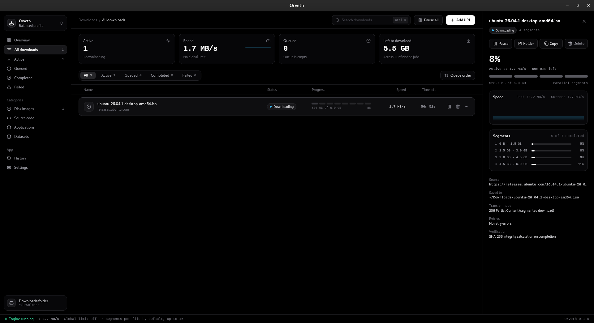
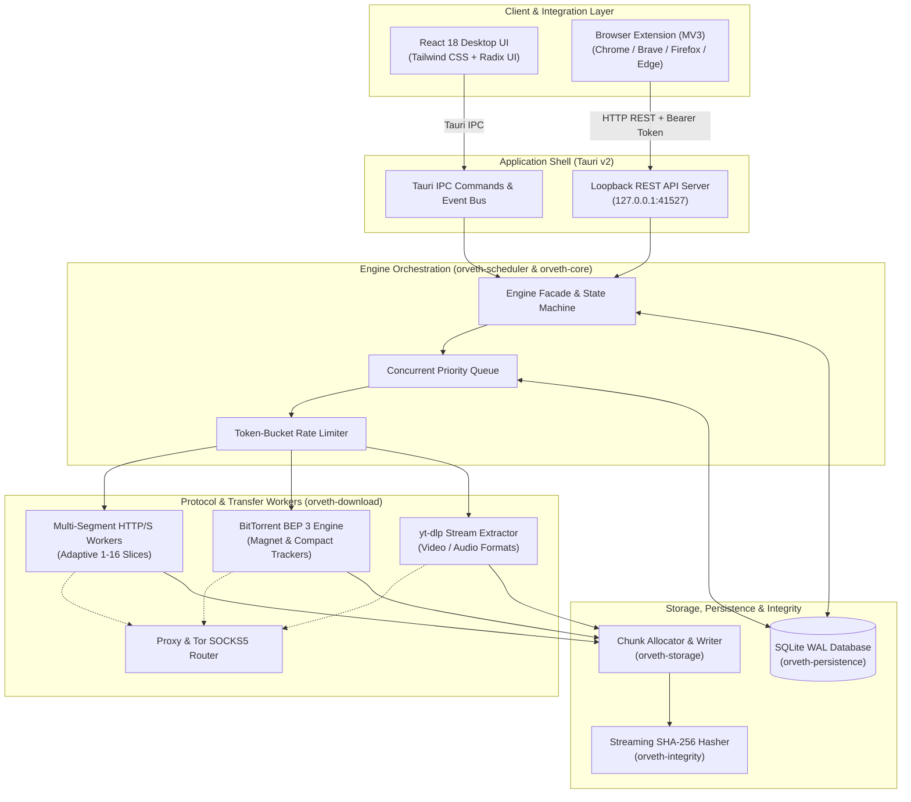

# Orveth

<p align="center">
  
</p>

<h3 align="center">High-Performance, Multi-Engine Accelerated Download Manager</h3>

<p align="center">
  A modern, power-user download manager built with <strong>Rust</strong>, <strong>Tauri v2</strong>, and <strong>React + TypeScript</strong>.<br />
  Engineered for extreme transfer speeds, local-first privacy, network resilience, and seamless browser integration.
</p>

<p align="center">
  <a href="https://github.com/mahin273/Orveth/actions/workflows/ci.yml"></a>
  
  
  
  
  
</p>

---

## Workspace Preview

<p align="center">
  
</p>

---

## Key Features

### Multi-Segment HTTP/HTTPS Acceleration
- **Dynamic Chunk Slicing**: Splits large files into up to 16 concurrent segmented streams.
- **Adaptive Concurrency**: Automatically detects server `Accept-Ranges` and fallback headers; seamlessly downscales to single-stream mode for stubborn servers.
- **Pre-Allocated Storage**: Sparse chunk allocation prevents disk fragmentation and ensures high write throughput without stuttering.

### BitTorrent & Magnet Link Engine
- **Pure Rust BEP 3 Protocol Implementation**: Pure Rust architecture without external C/C++ dependencies.
- **Magnet Link Parser**: Instant parsing of `xt=urn:btih:` hash digests, display names, and embedded announce trackers.
- **Compact Tracker Client**: UDP and HTTP tracker announcements with compact binary peer dictionary decoding.
- **Interactive Torrent Modal**: Inspect torrent metainfo, file hierarchies, and tracker endpoints before starting transfers.

### Integrated Media & Video Downloader (`yt-dlp`)
- **Web Media Extraction**: Resolves video and audio streams from supported media platforms and direct HTML5 feeds.
- **Stream Format Selection**: Inspect video codecs, resolutions (4K, 1080p, 720p, audio-only), and container sizes before dispatching.
- **Automated Binary Setup**: Background installer fetches and maintains the official standalone `yt-dlp` executable.

### Custom Proxy & Tor Network Routing
- **Comprehensive Protocol Support**: Route downloads through HTTP, HTTPS, or SOCKS5 proxies.
- **Tor Network Integration**: Native compatibility with the Tor daemon (`socks5h://127.0.0.1:9050`) for privacy-preserving routing.
- **Runtime Proxy Bypass**: Toggle proxies per-download or globally with real-time connectivity testing.

### Browser Companion Extension
- **Automatic Download Interception**: Captures native browser download events and seamlessly dispatches them to Orveth for acceleration.
- **Floating Video Capture Bar**: Detects playing HTML5 media elements on web pages with a one-click download panel.
- **Loopback Control API**: High-speed, secure local HTTP REST server (`http://127.0.0.1:41527`) authenticated via authorization tokens.

### Resilient Persistence & Integrity Verification
- **SQLite WAL Queue**: Complete ACID state persistence. Transfers survive crashes, system reboots, and sudden network dropouts.
- **Startup Reconciliation**: Interrupted or dangling jobs are automatically audited and recovered on application start.
- **Streaming SHA-256 Hasher**: Real-time checksum verification against expected digests with zero post-download file re-reading overhead.

### Precision Bandwidth Throttling
- **Token-Bucket Rate Limiting**: Configure global and per-download speed caps to prevent saturating network bandwidth.

---

## Downloads & Releases

Orveth provides official pre-built packages for modern Linux distributions and Windows:

| Platform | Format | Installation Command / Guide |
| :--- | :--- | :--- |
| **Linux (Universal)** | `.AppImage` | `chmod +x Orveth*.AppImage && ./Orveth*.AppImage` |
| **Debian / Ubuntu / Mint** | `.deb` | `sudo dpkg -i orveth_*_amd64.deb` |
| **Fedora / RHEL / openSUSE** | `.rpm` | `sudo rpm -ivh Orveth-*.x86_64.rpm` |
| **Windows 10 / 11** | `.exe` (NSIS) | Run `Orveth_*_x64-setup.exe` installer |

Check the latest release binaries on the [GitHub Releases Page](https://github.com/mahin273/Orveth/releases).

---

## Browser Extension Installation

1. Navigate to `extensions/browser/` (or download the packaged ZIP from GitHub Releases).
2. Open your Chromium-based browser (Chrome, Brave, Edge, Opera, Vivaldi) and navigate to `chrome://extensions`.
3. Enable **Developer mode** in the top-right corner.
4. Click **Load unpacked** and select the `extensions/browser/` directory.
5. In Firefox, navigate to `about:debugging#/runtime/this-firefox` and click **Load Temporary Add-on...**.

Detailed store publishing guidelines and privacy documentation:
- [Extension Privacy Policy](extensions/PRIVACY.md)

---

## Architecture

### System Architecture Diagram



### Workspace Structure

Orveth is organized as a Cargo workspace with strict domain separation between engine layers and the desktop UI:

```text
Orveth/
├── apps/
│   └── desktop/               # Tauri v2 shell + React 18 / Tailwind CSS UI
├── crates/
│   ├── orveth-core/           # Domain models, lifecycle state machines, URL sanitization
│   ├── orveth-download/       # HTTP segment workers, BitTorrent engine, yt-dlp extractor
│   ├── orveth-scheduler/      # Concurrent priority queue, rate limiter, local loopback API
│   ├── orveth-storage/        # Chunk file allocators, segment writers, atomic finalizer
│   ├── orveth-persistence/    # SQLite connection pooling, migrations, state recovery
│   └── orveth-integrity/      # Incremental SHA-256 streaming verification
├── extensions/
│   └── browser/               # Manifest V3 companion extension (intercept + video bar)
└── .github/
    └── workflows/ci.yml       # Multi-platform CI/CD (AppImage, deb, rpm, exe)
```

---

## Building from Source

### Prerequisites

- **Rust**: `1.80` or later (`rustup default stable`)
- **Node.js**: `v20+` & **pnpm**: `v9+`
- **Linux Dependencies** (Ubuntu/Debian):
  ```bash
  sudo apt-get install -y libwebkit2gtk-4.1-dev libgtk-3-dev libayatana-appindicator3-dev librsvg2-dev patchelf
  ```
- **Linux Dependencies** (Fedora):
  ```bash
  sudo dnf install -y webkit2gtk4.1-devel gtk3-devel libayatana-appindicator-devel librsvg2-devel
  ```

### Development Setup

1. **Clone the repository**:
   ```bash
   git clone https://github.com/mahin273/Orveth.git
   cd Orveth
   ```

2. **Run Rust unit and integration tests**:
   ```bash
   cargo test --workspace
   ```

3. **Install frontend dependencies**:
   ```bash
   cd apps/desktop
   pnpm install
   ```

4. **Launch the development application**:
   ```bash
   pnpm tauri dev
   ```

### Packaging for Release

```bash
cd apps/desktop
pnpm tauri build
```
Binaries and bundles will be placed in `apps/desktop/src-tauri/target/release/bundle/`.

---

## Contributing

We welcome community contributions, bug reports, and pull requests! Please read our [Contributing Guide](CONTRIBUTING.md) for details on code style, conventional commits, and review procedures.

---

## License

This project is licensed under the [MIT License](LICENSE).
