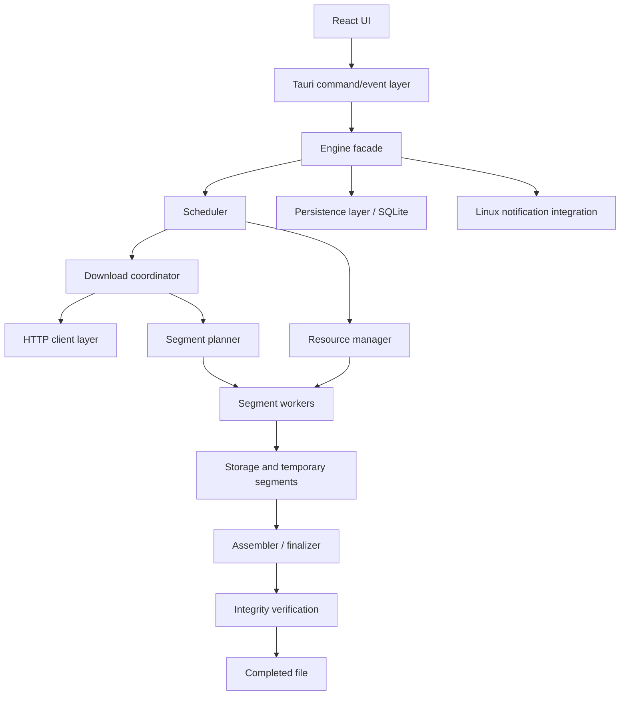
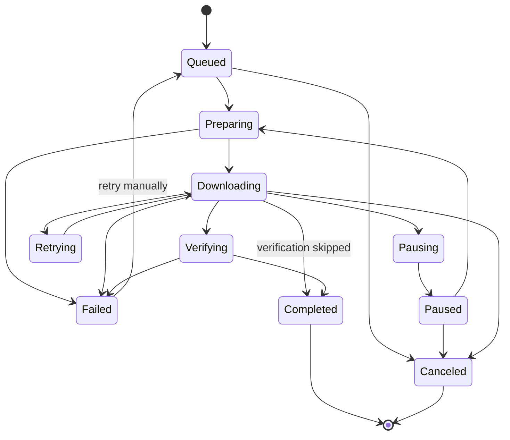

# Orveth — Engineering & Product Design Document

**Version:** 0.1 (Design baseline)  
**Status:** Proposed  
**Target:** Linux desktop, distributed as AppImage  
**Project name:** Orveth  
**Repository:** https://github.com/mahin273/Orveth (`git@github.com:mahin273/Orveth.git`)  
**Primary goal:** A fast, reliable, power-user download manager with an adaptive download engine and a clean Linux desktop experience.

---

## 1. Product vision

Orveth is a local-first Linux download manager built around a capable, independently testable download engine. It combines the familiar convenience of IDM-style download queues and controls with Linux integration, adaptive resource management, automation, and a scriptable interface.

### Product principles

1. **Engine first:** UI features must not compromise download correctness.
2. **Fast, not reckless:** concurrency and segmentation adapt to server capability and measured benefit.
3. **Reliable:** recover jobs after app or system restarts; preserve file integrity.
4. **Local-first:** queue, history, settings, and downloaded data remain on the user's machine by default.
5. **Transparent:** show useful status, errors, retry history, and verification results.
6. **Respectful:** throttle, schedule, or pause work to preserve user bandwidth, CPU, battery, and disk.
7. **Linux-native feeling:** standard desktop behavior, notifications, file access, and portable AppImage delivery.
8. **One engine, many interfaces:** GUI and CLI eventually use the same engine and state.

### Non-goals for v0.1

- Torrent support
- DRM circumvention or protected-stream extraction
- Site-specific bypasses, authentication circumvention, or access-control evasion
- Remote/cloud synchronization
- A plugin marketplace
- Browser extension
- Media extraction from arbitrary websites
- Embedded browser
- Electron-based packaging

---

## 2. Target users and use cases

### Primary user
A Linux desktop user who downloads large files, archives, software releases, datasets, media they are authorized to download, and other direct HTTP/HTTPS resources.

### Core use cases
- Add one or many direct download URLs.
- Select destination and filename.
- Pause, resume, retry, cancel, and reprioritize jobs.
- Download files using segmented transfers when supported and beneficial.
- Resume eligible downloads after interruptions.
- Schedule downloads and limit bandwidth.
- Verify files using hashes supplied by a trusted source.
- Organize downloads using categories and rules.
- View speed, progress, ETA, connection/segment status, and history.
- Recover the queue after restart.
- Package and run on supported Linux distributions via AppImage.

---

## 3. Release scope

### MVP (0.1)
- Direct HTTP/HTTPS downloads
- Redirect handling
- Range capability detection
- Segmented downloads for eligible files
- Single-stream fallback
- Pause/resume
- Queue and priority management
- Persistence and restart recovery
- Retry with backoff
- Destination and filename selection
- Global and per-job bandwidth caps
- SHA-256 verification (optional, user-supplied expected hash)
- Download categories (simple extension-based rules)
- Notifications on completion/failure
- Basic speed history and ETA
- AppImage packaging

### 0.2
- Scheduler
- Rule engine
- Clipboard URL detection (opt-in; no automatic download without confirmation)
- URL list import
- Queue export/import
- Detailed job panel
- Improved metrics and diagnostics

### 0.3
- CLI client
- Local control API
- Browser integration bridge (opt-in)
- Watch folders
- Advanced adaptive profiles

### Later / optional
- Browser extensions
- Media resource detection, only where permitted and without bypassing DRM or access controls
- Torrent subsystem
- Plugin system
- URL monitoring
- Remote control with explicit authentication and security design

---

## 4. UX and visual direction

### Design language
- Minimal, polished, desktop-first.
- No fake terminal widgets, glassmorphism, or excessive dashboard decoration.
- Use clear typography, spacing, compact data presentation, and restrained motion.
- Support dark and light themes.
- Make keyboard navigation and accessibility first-class.
- Avoid needless animated graphs or constant UI updates.

### Main navigation
- Overview
- All Downloads
- Active
- Queued
- Completed
- Failed
- Scheduled (later)
- Categories
- History
- Settings

### Main window layout
1. Sidebar with navigation and category counts.
2. Toolbar with Add URL, search, and global actions.
3. Optional overview cards: active count, total speed, queued count, completed count.
4. Main download list.
5. Optional details drawer for selected job.

### Download list row
- Filename and file type icon
- Status and progress bar
- Downloaded / total bytes
- Current speed
- ETA
- Pause/resume control
- Overflow menu: open, reveal in file manager, copy URL, rename, change destination where safe, retry, cancel, remove from history

### Add-download dialog
- URL input (one URL for MVP)
- Optional filename
- Destination picker
- Optional expected SHA-256
- Advanced options collapsed by default
- Validation feedback
- Add / Add and start

### Job detail panel
- URL (masked where it contains sensitive query data)
- Destination
- Status
- Progress
- Speed chart
- ETA
- Segment count and segment state (when segmented)
- Retry history
- HTTP response metadata (limited and sanitized)
- Hash verification status
- Error explanation and actionable recovery options

### States
- Queued
- Preparing
- Downloading
- Pausing
- Paused
- Retrying
- Verifying
- Completed
- Failed
- Canceled
- Needs attention (e.g., destination unavailable)

### UX rules
- Confirm destructive actions such as deleting a partial file.
- Cancel is distinct from removing a completed item from history.
- Never imply a hash is trustworthy if no trusted expected hash was provided.
- Never label a file “verified” solely because hashing completed; distinguish “hash calculated” from “matches expected hash”.
- Provide concise errors and a “details” section for technical information.
- Clipboard monitoring is opt-in, and detected URLs require user confirmation.

---

## 5. Technology stack

| Layer | Technology | Notes |
|---|---|---|
| Desktop shell | Tauri 2 | AppImage packaging, native desktop integration |
| Frontend | React + TypeScript | UI only; no download logic |
| UI styling | Tailwind CSS | Design tokens and responsive layouts |
| Components | shadcn/ui or equivalent | Accessible component baseline; customize visuals |
| Motion | Motion (optional) | Restrained transitions |
| Engine | Rust | Core download engine |
| Async runtime | Tokio | Worker tasks and async I/O |
| HTTP | reqwest initially | Reuse clients; tune only after profiling |
| Persistence | SQLite | Local job/settings/history store |
| DB access | SQLx | Typed async queries and migrations |
| Charts | Lightweight chart library (optional) | Speed history |
| Testing | Rust unit/integration tests + UI tests | Engine correctness is the priority |
| Packaging | AppImage | Build, smoke-test, and document supported systems |

### Architecture decision
Use the Tauri process to host the Rust engine initially. Keep the engine crate independent of Tauri so it can be reused by a future CLI or service. Do not split into separate processes until a real need exists.

---

## 6. System architecture



### Dependency direction
- UI calls Tauri commands and listens to events.
- Tauri layer calls the engine facade.
- Engine modules must not depend on React, UI state, or Tauri.
- Persistence is accessed through repository interfaces.
- HTTP, storage, and clock components should be injectable for tests.

### Proposed repository structure

```text
orveth/
├── apps/
│   └── desktop/                  # Tauri + React frontend
│       ├── src/
│       ├── src-tauri/
│       └── package.json
├── crates/
│   ├── orveth-core/              # Models, engine facade, lifecycle
│   ├── orveth-download/           # HTTP and transfer implementation
│   ├── orveth-scheduler/          # Queue and scheduling
│   ├── orveth-storage/            # Files, segments, atomic finalization
│   ├── orveth-persistence/        # SQLite repositories and migrations
│   ├── orveth-integrity/          # Hashing and verification
│   ├── orveth-rules/              # Later: rules
│   └── orveth-cli/               # Later: CLI
├── docs/
├── tests/
├── scripts/
└── README.md
```

---

## 7. Download engine design

### 7.1 Lifecycle
Each job follows a controlled state machine. State transitions are validated by the engine, not the UI.



### 7.2 Server capability detection
Before segmented downloading:
- Send a conservative capability request (HEAD where useful, otherwise a small GET with a Range header).
- Handle servers that ignore HEAD.
- Determine whether range requests appear supported.
- Determine content length when available.
- Detect redirects and final URL.
- Treat capability information as provisional; validate response headers on actual segment requests.
- Fall back to a single-stream transfer when segmentation is unsupported or unsafe.

Do not use capability checks to evade server restrictions. Respect response codes, Retry-After, and server behavior.

### 7.3 Segmentation policy
- Segment only when the resource is eligible, has a usable length, and range responses are validated.
- Keep segment count configurable and capped.
- Use a conservative default; adapt based on observed throughput and errors.
- Do not increase concurrency if it does not improve throughput.
- If a server returns inconsistent range metadata, stop segmented mode and safely fall back or fail with a clear error.
- Ensure segments cover the file without gaps or overlaps.
- Each segment has its own state and byte counters.
- Segment retries must not corrupt other completed segments.
- Use bounded worker concurrency.

### 7.4 Segment validation
For each segment request:
- Validate HTTP status is appropriate for the requested range.
- Validate Content-Range against the requested byte interval and total size.
- Validate Content-Length where present.
- Reject unexpected full-file responses for a segment.
- Ensure received byte count matches the segment's expected length.
- Do not write a response into the wrong segment.
- On validation failure, terminate or safely restart the affected transfer.

### 7.5 Single-stream fallback
- Use for unknown-length files, unsupported range requests, or unsafe segmentation.
- Support pause/resume where server and local state permit.
- Store partial data in a temporary file.
- Use bounded retries and explain when resume is not possible.

### 7.6 Retry policy
- Retry only retryable failures.
- Use exponential backoff with jitter and a maximum delay.
- Respect Retry-After.
- Bound retries; configurable retry limit.
- Retry network timeouts, transient connection failures, and selected transient HTTP status codes.
- Do not retry invalid URLs, permission errors, disk-full errors, or permanent client errors endlessly.
- Provide a user-visible retry reason and retry count.

### 7.7 Pause, cancel, and shutdown
- Pause stops scheduling new segment work and safely checkpoints active work.
- Cancel stops workers, cleans up or preserves temporary files according to user choice, and updates persistence.
- Shutdown requests graceful engine stop, checkpoints jobs, and waits within a bounded period.
- Avoid abrupt termination of workers when possible.
- On restart, reconcile database state with actual temporary files before resuming.

### 7.8 Download finalization
- Write to a temporary destination, not the final filename.
- Validate all segments or the single-stream file.
- Assemble segmented data into a temporary complete file.
- Flush and close files.
- Perform optional hash verification.
- Finalize using an atomic rename where supported and practical.
- Handle destination collisions through an explicit policy (ask, rename, or overwrite with confirmation).
- Never silently overwrite user files.

---

## 8. Resource management

### 8.1 Limits
- Global active-download limit
- Per-job segment limit
- Global segment-worker limit
- Global bandwidth limit
- Per-job bandwidth limit
- Disk I/O buffering controls
- Optional battery-aware behavior (later)

### 8.2 Adaptive profile
Profiles:
- **Balanced:** conservative adaptive concurrency.
- **Turbo:** higher configured limits, still server-respectful and bounded.
- **Quiet:** lower concurrency and bandwidth.
- **Battery:** reduced work on battery, later.
- **Custom:** user settings.

Profiles must never override server restrictions or integrity validation.

### 8.3 Bandwidth limiter
Implement a shared token-bucket or equivalent rate limiter:
- Global cap
- Optional per-job cap
- Live changes to cap
- Fair distribution among active jobs
- Correct behavior when unlimited
- Test for starvation and burst behavior

### 8.4 UI event throttling
- Internal measurements may be frequent.
- Emit UI progress events at a controlled interval (suggestion: 4–10 updates per second) and on meaningful state transitions.
- Coalesce events.
- Avoid unnecessary React rerenders.
- Preserve accurate final counters.

---

## 9. Persistence and data model

SQLite is the source of truth for queue metadata, settings, and history. Files and segment metadata must be reconciled on startup.

### 9.1 Tables

#### `downloads`
| Column | Type | Description |
|---|---|---|
| id | TEXT PK | UUID |
| url | TEXT | Original URL (protect display/logs) |
| final_url | TEXT nullable | Redirected URL |
| file_name | TEXT | User-facing filename |
| destination | TEXT | Destination path |
| temp_path | TEXT nullable | Temporary file/path |
| total_bytes | INTEGER nullable | Total length |
| downloaded_bytes | INTEGER | Current verified/received bytes |
| status | TEXT | Lifecycle state |
| category | TEXT nullable | Category |
| priority | INTEGER | Priority |
| created_at | TEXT | Timestamp |
| updated_at | TEXT | Timestamp |
| completed_at | TEXT nullable | Timestamp |
| retry_count | INTEGER | Retry count |
| retry_limit | INTEGER | Retry limit |
| expected_hash | TEXT nullable | User-supplied hash |
| hash_algorithm | TEXT nullable | Hash algorithm |
| verification_status | TEXT | Not requested / calculated / matched / mismatch / error |
| segmented | INTEGER | Whether segmented mode was used |
| last_error_code | TEXT nullable | Internal error code |
| last_error_message | TEXT nullable | Sanitized message |

#### `segments`
| Column | Type | Description |
|---|---|---|
| id | TEXT PK | Segment UUID |
| download_id | TEXT FK | Parent job |
| start_byte | INTEGER | Inclusive start |
| end_byte | INTEGER | Inclusive end |
| received_bytes | INTEGER | Received bytes |
| status | TEXT | Segment state |
| temp_path | TEXT | Segment storage |
| retry_count | INTEGER | Segment retries |
| updated_at | TEXT | Timestamp |

#### `settings`
| Column | Type | Description |
|---|---|---|
| key | TEXT PK | Setting name |
| value_json | TEXT | Value |

#### `download_events` (optional in MVP)
| Column | Type | Description |
|---|---|---|
| id | INTEGER PK | Event id |
| download_id | TEXT | Job id |
| event_type | TEXT | Event type |
| message | TEXT | Sanitized message |
| created_at | TEXT | Timestamp |

### 9.2 Persistence rules
- Use SQLite migrations.
- Use transactions for lifecycle and segment-state updates.
- Do not persist secrets in plain-text event logs.
- URLs may contain credentials or signed tokens; mask them in UI and logs.
- Reconcile segment files and metadata on startup.
- Use a WAL mode where appropriate, with safe configuration and backups.
- Avoid storing large file contents in SQLite.

### 9.3 Recovery
At startup:
1. Load jobs not in terminal states.
2. Inspect temp paths and segment files.
3. Validate segment metadata and file lengths.
4. Mark irrecoverable state as Needs attention.
5. Resume eligible jobs only after reconciliation.
6. Never assume database byte counters equal actual file bytes without validation.

---

## 10. Engine API and UI communication

Tauri commands form the initial UI boundary. Keep payloads versionable and typed.

### Commands (MVP)
- `add_download(input)`
- `start_download(id)`
- `pause_download(id)`
- `resume_download(id)`
- `cancel_download(id, delete_partial)`
- `retry_download(id)`
- `remove_download(id, remove_file)`
- `list_downloads(filters)`
- `get_download(id)`
- `get_settings()`
- `update_settings(settings)`
- `set_global_bandwidth_limit(limit)`
- `set_job_bandwidth_limit(id, limit)`
- `verify_download(id, hash_spec)`
- `open_file(id)`
- `reveal_file(id)`

### Event types
- `download_state_changed`
- `download_progress`
- `download_speed`
- `segment_state_changed`
- `download_completed`
- `download_failed`
- `verification_state_changed`
- `queue_changed`
- `engine_status_changed`

### Payload design
- Use UUID identifiers.
- Use byte counts as integer values.
- Use timestamps in a consistent UTC format.
- Use explicit nullable fields.
- Include schema/version fields for long-lived events if needed.
- Sanitize secrets in URLs and error messages.
- UI events are informational; commands and database state remain authoritative.

---

## 11. Security and privacy

- Local-first; no telemetry by default.
- If telemetry is added later, it must be opt-in and documented.
- Do not expose an unauthenticated remote API.
- Browser integration must be opt-in and have a clear permission model.
- Protect local control endpoints against CSRF, origin abuse, and unauthorized clients if introduced.
- Never execute downloaded files automatically.
- Do not trust filenames supplied by remote servers; sanitize path separators, control characters, and traversal sequences.
- Restrict writes to user-selected destinations and safe temporary locations.
- Avoid logging signed URLs, cookies, authorization headers, or sensitive query parameters.
- Store secrets only if required; use OS keyring where practical.
- Hash verification must distinguish a locally computed digest from a match against a trusted expected digest.
- Do not bypass DRM, paywalls, authentication, or access controls.
- Respect server rate limits and Retry-After.

---

## 12. Linux integration and AppImage

### Linux desktop integration
- Desktop notifications on completion/failure
- Open file using default handler
- Reveal file in file manager
- Clipboard URL detection (opt-in)
- Startup behavior (opt-in)
- File chooser for destination
- System tray only if it is reliable and not required for core usability
- Respect dark/light desktop preference where feasible

### AppImage
- Build AppImage in CI for a documented target baseline.
- Bundle required application libraries where licensing and packaging rules allow.
- Avoid bundling system components that should remain external.
- Test on multiple distributions and desktop environments.
- Provide SHA-256 checksums for releases.
- Sign release artifacts if practical.
- Document known compatibility requirements.
- Test launch, downloads, pause/resume, restart recovery, notifications, file chooser, and file-open/reveal actions in the packaged build.
- Do not claim universal compatibility; publish tested environments.

---

## 13. Testing strategy

### 13.1 Engine unit tests
- State-transition validation
- Segment planner correctness
- Retry/backoff behavior
- Filename sanitization
- URL masking
- Bandwidth limiter
- Queue ordering and priority
- Hash calculation
- Recovery reconciliation

### 13.2 HTTP integration tests
Use a controllable local test server with cases:
- Range supported
- Range ignored
- Invalid Content-Range
- Missing content length
- Redirect
- Slow response
- Interrupted response
- Retryable status
- Permanent status
- Retry-After
- Truncated body
- Content changes during transfer
- Range response with wrong length
- Concurrent segment requests

### 13.3 Filesystem tests
- Disk full simulation where feasible
- Permission failure
- Destination disappears
- Existing filename collision
- Interrupted finalization
- Partial files after crash
- Path traversal filename attempts
- Segment assembly correctness

### 13.4 UI tests
- Add URL validation
- State rendering
- Pause/resume actions
- Queue filtering
- Details panel
- Error messages
- Keyboard navigation
- Accessibility basics

### 13.5 End-to-end tests
- Single-stream download
- Segmented download
- Pause/resume
- Restart recovery
- Retry after interruption
- Hash match and mismatch
- Queue prioritization
- AppImage smoke test

### 13.6 Performance tests
Benchmark on documented hardware/network:
- Single-stream throughput
- Segmented throughput versus single stream
- Memory usage across many queued jobs
- CPU usage at different concurrency settings
- UI responsiveness with large queue
- Event overhead
- Startup and recovery time
- Disk write behavior

Performance claims must be based on repeatable measurements, not assumed from the language or architecture.

---

## 14. Observability and diagnostics

- Structured logs with levels.
- Per-job correlation ID.
- Sanitized error codes and messages.
- Retry history.
- Engine-level metrics.
- Optional diagnostics export.
- Diagnostics export must exclude credentials, cookies, authorization headers, and sensitive URL query parameters by default.
- Logs should have bounded size and retention.
- Avoid logging file contents.

---

## 15. Settings

### General
- Default destination
- Ask for destination on each download
- Start application behavior
- Notification preferences
- Theme: system/light/dark
- Clipboard monitoring: off by default

### Downloads
- Global active jobs
- Default segmented mode
- Default segment limit
- Retry limit
- Default category rules
- Filename collision behavior
- Hash verification preferences

### Network
- Global bandwidth limit
- Per-job limit defaults
- Proxy configuration (MVP scope to be evaluated)
- Network profile
- Timeout settings (advanced)

### Storage
- Temp directory
- Cleanup behavior
- Completed history retention
- Temporary-file retention on cancel

### Advanced
- Diagnostic logging level
- UI update frequency (only if useful)
- Engine limits
- Export/import settings

---

## 16. MVP acceptance criteria

A release is not MVP-ready unless all are true:

1. User can add a valid direct HTTP/HTTPS URL.
2. File is downloaded to the selected destination.
3. Progress, speed, and ETA are reasonably accurate.
4. Pause and resume work when supported.
5. Segmented mode validates range responses and safely falls back.
6. Segment assembly produces a correct file.
7. Retry policy is bounded and transparent.
8. Queue state survives application restart.
9. Recovery reconciles metadata and files before resuming.
10. User can cancel and choose whether to preserve partial data.
11. Global bandwidth cap works.
12. SHA-256 is calculated when requested.
13. Expected-hash match/mismatch is clearly reported.
14. Existing files are not silently overwritten.
15. Remote filenames are safely sanitized.
16. Logs and UI mask sensitive URL data.
17. UI remains responsive with a substantial queued list.
18. AppImage launches on documented test environments.
19. Packaged build passes core end-to-end tests.
20. No download is executed automatically.

---

## 17. Suggested implementation order

### Sprint 0 — project setup
- Workspace and crate structure
- Tauri skeleton
- React UI skeleton
- CI and linting
- SQLite migrations
- Logging and error types

### Sprint 1 — single-stream engine
- URL validation
- HTTP client
- Destination and filename handling
- Temporary file
- Progress reporting
- Basic lifecycle states
- Integration tests

### Sprint 2 — persistence and recovery
- Job repository
- State persistence
- Recovery reconciliation
- Pause/resume
- Shutdown checkpointing

### Sprint 3 — queue and retries
- Queue manager
- Priority
- Retry policy
- Error categorization
- Multiple active downloads

### Sprint 4 — segmented engine
- Range capability detection
- Segment planner
- Worker pool
- Segment validation
- Assembly
- Fallback
- Extensive integration tests

### Sprint 5 — desktop UI
- Main layout
- Download list
- Add dialog
- Progress and controls
- Details panel
- Search/filter

### Sprint 6 — resource control and integrity
- Bandwidth limiter
- Concurrency settings
- Hashing
- Verification states
- Notifications

### Sprint 7 — polish and release
- Settings
- Category rules
- AppImage
- Packaging smoke tests
- Documentation
- Release checksums

---

## 18. AI-assisted development guidelines

Use AI coding agents in small, reviewable implementation chunks.

### Workflow
1. Read the design document and current repository state.
2. Select one task with clear acceptance criteria.
3. Create a task branch from `develop` (see section 19).
4. Review module boundaries and dependency direction.
5. Write or update tests before implementation where practical.
6. Implement only the selected task.
7. Run formatting, linting, unit tests, and relevant integration tests.
8. Review the diff for correctness, security, and scope.
9. Update docs and task status.
10. Commit on the task branch using the commit convention in section 19.
11. Open a pull request into `develop`; merge only after checks pass and the diff is reviewed.
12. Move to the next task only after the current chunk is merged.

### Agent rules
- Do not implement multiple unrelated modules in one task.
- Do not silently change architecture or dependencies.
- Do not weaken tests to make a task pass.
- Do not claim tests ran unless their output confirms it.
- Do not leave placeholder implementations in core paths without documenting them.
- Prefer explicit error handling over panics in application code.
- Do not add telemetry, remote services, or automatic execution without approval.
- Treat URL, filenames, HTTP headers, and server responses as untrusted data.
- Keep the engine independent of UI framework code.
- Keep tasks small enough for meaningful review.
- Never commit or push directly to `main` or `develop`.
- Never force-push, rewrite shared history, or delete branches without approval.
- One task = one branch = one pull request.

---

## 19. GitHub workflow and rules

Branch-based workflow. `main` is always releasable; all work lands through pull requests.

### 19.0 Repository info

| Item | Value |
|---|---|
| Project | Orveth |
| Owner | `mahin273` |
| Repository | https://github.com/mahin273/Orveth |
| Remote (SSH) | `git@github.com:mahin273/Orveth.git` |
| Default branch | `main` |
| Integration branch | `develop` |

One-time bootstrap (the initial commit on `main` is the only direct push allowed; enable branch protection right after):

```bash
echo "# Orveth" >> README.md
git init
git add README.md
git commit -m "chore: initial commit"
git branch -M main
git remote add origin git@github.com:mahin273/Orveth.git
git push -u origin main

# create the integration branch
git switch -c develop
git push -u origin develop
```

Then in GitHub: set `develop` as the default branch for PRs (optional) and apply the rules in 19.6.

### 19.1 Long-lived branches

| Branch | Purpose | Rules |
|---|---|---|
| `main` | Released, stable code. Every commit is a release candidate; tags are cut here. | Protected. PR-only. No direct pushes. |
| `develop` | Integration branch for completed work. | Protected. PR-only. Must stay green. |

### 19.2 Short-lived branches

| Prefix | Branched from | Merges into | Use |
|---|---|---|---|
| `feature/<scope>-<short-desc>` | `develop` | `develop` | New functionality |
| `fix/<scope>-<short-desc>` | `develop` | `develop` | Non-urgent bug fixes |
| `refactor/<scope>-<short-desc>` | `develop` | `develop` | Behavior-preserving changes |
| `test/<scope>-<short-desc>` | `develop` | `develop` | Test-only changes |
| `docs/<short-desc>` | `develop` | `develop` | Documentation |
| `chore/<short-desc>` | `develop` | `develop` | Tooling, CI, dependencies |
| `release/vX.Y.Z` | `develop` | `main` (then back-merge to `develop`) | Release stabilization: version bump, changelog, packaging fixes only |
| `hotfix/vX.Y.Z-<short-desc>` | `main` | `main` (then back-merge to `develop`) | Urgent production fixes |

Naming rules:
- Lowercase, hyphen-separated, no spaces.
- `<scope>` matches a crate or area: `core`, `download`, `scheduler`, `storage`, `persistence`, `integrity`, `ui`, `tauri`, `ci`, `packaging`.
- Examples: `feature/download-segment-planner`, `fix/persistence-recovery-offsets`, `chore/ci-appimage-build`.
- One task per branch; keep branches short-lived (target: merged within days, not weeks).
- Rebase or merge `develop` into the branch regularly to avoid drift.

### 19.3 Commit convention

Use Conventional Commits: `<type>(<scope>): <summary>`

- Types: `feat`, `fix`, `refactor`, `test`, `docs`, `chore`, `perf`, `build`, `ci`.
- Summary: imperative mood, lowercase, no trailing period, 72 characters or fewer.
- Body (optional): explain why, not what. Reference the issue (`Closes #12`).
- Breaking changes: add `!` after the scope and a `BREAKING CHANGE:` footer.
- Examples:
  - `feat(download): add segment planner with gap and overlap checks`
  - `fix(persistence): reconcile byte counters with temp file length`
  - `ci(packaging): build AppImage on tagged releases`
- Small, atomic commits; each commit should build and pass tests where practical.
- Never commit secrets, credentials, signed URLs, local databases, downloaded test files, or build artifacts.

### 19.4 Pull request rules

- Every change reaches `develop` or `main` through a PR; no direct pushes.
- PR title follows the commit convention.
- Keep PRs small and scoped to one task; unrelated changes go in a separate PR.
- Link the related issue or sprint task.
- PR description includes: summary, what changed, how it was tested, and any risks (persistence, security, recovery).
- Required before merge:
  - All CI checks pass (see 19.5).
  - Branch is up to date with its base.
  - All review conversations resolved.
  - Self-review of the diff completed (and AI-generated diffs reviewed line by line).
  - Docs and migrations updated if behavior or schema changed.
- Merge strategy:
  - Task branch → `develop`: squash merge (one clean commit per task).
  - `release/*` and `hotfix/*` → `main`: merge commit (preserves release history).
  - Back-merge `main` → `develop` after every release or hotfix.
- Delete the task branch after merge.

### 19.5 Required CI checks

Run on every PR and on pushes to `develop` and `main`:
- `cargo fmt --check`
- `cargo clippy --workspace --all-targets -- -D warnings`
- `cargo test --workspace`
- Frontend lint, type-check, and tests (`pnpm lint`, `pnpm typecheck`, `pnpm test`)
- SQLx migration check (migrations apply cleanly to an empty database)
- Dependency and license audit (`cargo audit`, `cargo deny`)
- Tauri build check; AppImage build on `release/*` branches and tags

### 19.6 Branch protection (GitHub settings)

Apply to `main` and `develop`:
- Require a pull request before merging.
- Require status checks to pass and branches to be up to date.
- Require conversation resolution before merging.
- Require linear history on `develop` (squash merges only).
- Block force pushes and branch deletion.
- Include administrators in the rules.
- Optional: require signed commits; require one approving review once there is more than one contributor.

### 19.7 Releases and tags

- Versioning: Semantic Versioning (`vMAJOR.MINOR.PATCH`); pre-1.0 releases use `v0.x.y`.
- Release flow:
  1. Create `release/vX.Y.Z` from `develop`.
  2. Bump versions, update `CHANGELOG.md`, run the full test suite and AppImage smoke tests.
  3. Merge into `main` via PR, then tag `vX.Y.Z` on `main`.
  4. CI builds the AppImage and publishes a GitHub Release with SHA-256 checksums.
  5. Back-merge `main` into `develop`.
- Tags are annotated and never moved or deleted once published.
- Hotfixes follow the same tag and back-merge steps.

### 19.8 Repository hygiene

- Required root files: `README.md`, `LICENSE`, `CHANGELOG.md`, `CONTRIBUTING.md` (branch and commit rules), `.gitignore`.
- Add `.github/` with `pull_request_template.md`, issue templates, `CODEOWNERS`, and CI workflows.
- `.gitignore` covers: `target/`, `node_modules/`, `dist/`, `*.AppImage`, local SQLite files (`*.db`, `*.db-wal`, `*.db-shm`), `.env*`, and test download output.
- Enable secret scanning and Dependabot alerts.
- Track work with GitHub Issues and a Project board; one issue per task, labeled by scope and type.

### 19.9 Daily command reference

```bash
# start a task
git switch develop && git pull --ff-only
git switch -c feature/download-segment-planner

# work, then commit
git add -p
git commit -m "feat(download): add segment planner"

# stay current with develop
git fetch origin && git rebase origin/develop

# publish and open PR
git push -u origin feature/download-segment-planner
gh pr create --base develop --fill

# after merge
git switch develop && git pull --ff-only
git branch -d feature/download-segment-planner
```

---

## 20. Risks and mitigations

| Risk | Mitigation |
|---|---|
| Server does not support ranges | Detect, validate and use single-stream fallback |
| Server throttles or rejects concurrent requests | Adaptive bounded concurrency, backoff, respect Retry-After |
| Resume state is inconsistent | Reconcile DB and filesystem; validate bytes |
| Segments produce corrupt file | Strict range validation, tests, assembly validation |
| Downloaded filename is unsafe | Sanitize and constrain destination |
| Disk fills | Check space where possible, handle write errors, stop safely |
| UI becomes sluggish | Event throttling, virtualized list if necessary |
| AppImage portability issues | Test documented distribution matrix |
| Sensitive URL leakage | Mask URLs and sanitize logs |
| Scope creep | Strict MVP scope and phased roadmap |

---

## 21. Open decisions

Resolve these through small technical spikes rather than guessing:

- Which HTTP client behavior is needed beyond reqwest defaults?
- What conservative default segment count performs well across test servers?
- What AppImage build baseline best matches target Linux systems?
- Is system tray support reliable across target desktops and worth including?
- Which proxy types are needed in the first release?
- How should filename collisions be presented?
- Which chart library adds the least UI overhead?
- When, if ever, should the engine move to a separate process?

---

## 22. Definition of done for each task

A task is done when:
- Requirements and acceptance criteria are satisfied.
- Tests are added or updated.
- Relevant tests pass.
- Formatting and linting pass.
- Errors are handled and surfaced.
- No unrelated changes are included.
- Documentation is updated if behavior or architecture changes.
- The implementation is reviewed against security, persistence, and recovery concerns.
- Work was done on a task branch, follows the commit convention, and was merged through a PR with passing CI (section 19).

---

**End of design document.**
